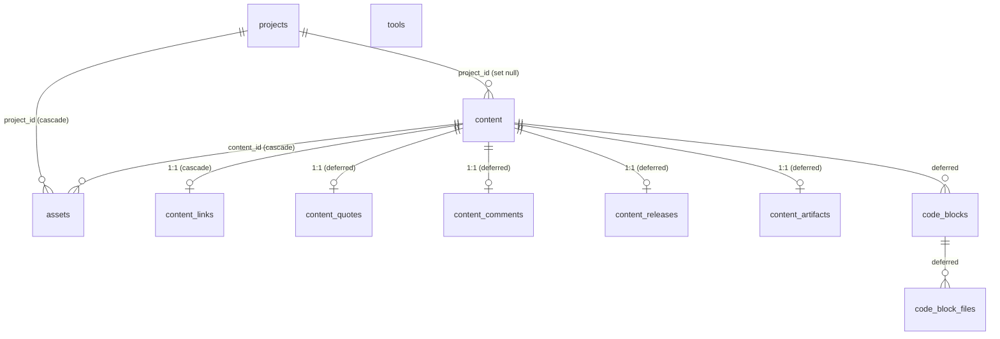

# Content database schema

This doc explains the schema as it stands and lists open questions and gaps to settle before the first `db:push`.

- [schema.dbml](schema.dbml) is the **full design**: every table we expect to need.
- [schema.ts](schema.ts) is the **v1 subset** that actually gets built: `projects`, `content`, `content_links` and `assets`.
- Everything else in the DBML is designed but deferred.

## Goals the schema serves

1. **One central content store**, separate from this site. The site reads from it. Agents write to it through an API, and later an MCP server.
2. **Every kind of thing I publish is a row in `content`.** That covers posts, links, quotes, comments, releases, artifacts and images. One feed, one slug namespace, one set of tags.
3. **Type-specific data lives in 1:1 detail tables**, so `content` stays narrow and every row uses every column.
4. **Media is centralized in `assets`**, rather than scattered `thumbnail` / `logo` / `images` columns.
5. **The rules live in the database where possible** (check constraints and unique indexes), not just in app code. Clients other than this site will write to it too.

## Overview

| Table | Status | Purpose |
| --- | --- | --- |
| `content` | v1 | Every publishable item: shared fields and the body |
| `content_links` | v1 | Extra fields for `type = link` |
| `projects` | v1 | Things I've built, from experiments to full projects; content can belong to one |
| `assets` | v1 | Images and video for content or projects |
| `content_quotes` | deferred | Extra fields for `type = quote` |
| `content_comments` | deferred | Extra fields for `type = comment` (comments I left elsewhere) |
| `content_releases` | deferred | Extra fields for `type = release` |
| `content_artifacts` | deferred | Self-contained HTML for `type = artifact` |
| `code_blocks`, `code_block_files` | deferred | Multi-file code blocks (the tabbed / explorer component) |
| `tools` | deferred | Standalone list behind the "tools I use" page |

## Conventions used across tables

**IDs**
- Content and projects use `text` UUIDs, generated in JS through `$defaultFn(() => crypto.randomUUID())`.
- `assets` uses an integer autoincrement ID, because nothing external refers to it.
- Slugs are the public, human-readable key. IDs are the stable internal one, so a slug can change without breaking foreign keys.

**Timestamps**
- Stored as ISO-8601 UTC text (`2026-10-11T12:00:00.000Z`), which sorts correctly as text.
- `created_at` and `updated_at` have database defaults through `strftime`.
- `updated_at` is bumped by Drizzle's `$onUpdateFn`.

**Enums**
- Each enum is a `const` array in `schema.ts` (`contentTypes`, `statuses`, `authorships`, `formats`, `projectKinds`, `assetKinds`, `assetRoles`).
- Each array is used twice: as the Drizzle `enum` (for TypeScript types) and as an `in (...)` check constraint (so the database enforces it too).

**Lists**
- `tags` and `authors` are JSON arrays stored in a `text` column (`mode: "json"`).
- This is simple for v1. A real `tags` table is deferred.

**Detail tables**
- The primary key is `content_id`, which is also the foreign key to `content.id` with `on delete cascade`.
- That makes the relationship 1:1 by construction.

## Tables in v1

### `content`

The spine. Every item, whatever its type, has exactly one row here.

| Column | Type | Notes |
| --- | --- | --- |
| `id` | text PK | UUID |
| `slug` | text, unique, not null | Unique across **all** types, not per type |
| `type` | text, not null | v1: `post \| link \| image`. Design: also `quote \| comment \| release \| artifact` |
| `status` | text, not null, default `draft` | `draft \| published \| private` |
| `title` | text, not null | |
| `description` | text | Summary; used for meta description and cards |
| `body` | text | Markdown or MDX source |
| `format` | text, not null, default `md` | `md \| mdx \| component`. `component` = the body is a TSX file in the repo, not in `body` |
| `component_key` | text | Registry key for the TSX body (e.g. `schema-explainer`). Required when `format = 'component'` (check constraint) |
| `content_hash` | text | Change detection for sync (see gaps) |
| `authors` | JSON text | `string[]` |
| `authorship` | text, not null, default `ai-assisted` | `human \| ai-assisted \| ai-generated`. Only `human` and `ai-generated` get a badge |
| `authorship_note` | text | Free-text story of how the piece was made |
| `tags` | JSON text | `string[]` |
| `project_id` | text FK → `projects.id` | `on delete set null` |
| `published_at` | text | When it went live. Feeds sort by this |
| `revised_at` | text | Set by hand for meaningful updates. Shown to readers and used as `og:modified_time` |
| `created_at` / `updated_at` | text, not null | Automatic |

Constraints and indexes:
- `type`, `status` and `authorship` are each checked against their enum.
- `content_published_has_date`: a published row must have `published_at`.
- Indexes on `project_id` and `published_at`.

The three dates mean different things:
- `published_at` is when readers first saw it.
- `revised_at` is when I meaningfully changed it, and is shown to readers.
- `updated_at` is when the row last changed for any reason, typo fixes included. Machine use only.

### `content_links` (v1)

| Column | Notes |
| --- | --- |
| `content_id` | PK and FK, cascade |
| `target_url` | not null; the page being linked to |
| `target_title` | That page's title (my own title for the post is `content.title`) |
| `via_url`, `via_name` | Where I found it, e.g. Hacker News |

### `projects` (v1)

| Column | Notes |
| --- | --- |
| `id`, `slug`, `title` | Same pattern as `content` |
| `tagline`, `description` | Short and long text |
| `kind` | `experiment \| project`, default `project`. Experiments are exploratory and may be abandoned. Graduating is a field edit |
| `status` | Same enum as content (`draft \| published \| private`) |
| `icon` | Lucide icon name; a fallback when there's no `logo` asset |
| `app_href` | Internal link (e.g. `/apps/foo`) |
| `repo_url`, `demo_url`, `video_url` | External links |
| `tags` | JSON array |
| `sort_order` | Manual ordering on the projects page |

### `assets` (v1)

| Column | Notes |
| --- | --- |
| `id` | Integer autoincrement |
| `project_id` / `content_id` | **Exactly one** is set (check constraint `assets_one_owner`). Both cascade on delete |
| `url` | not null |
| `kind` | `image \| video`, default `image` |
| `role` | `thumbnail \| hero \| logo \| gallery` |
| `alt` | Required for images in practice, but not enforced |
| `width`, `height` | For layout and avoiding layout shift |
| `sort_order` | Order within a gallery |

Partial unique indexes allow at most one `thumbnail`, `hero` and `logo` per owner. `gallery` can repeat.

## Designed but deferred

| Table | Key fields | Notes |
| --- | --- | --- |
| `content_quotes` | `quote` (not null), `author`, `source_url`, `source_title`, `via_url`, `via_name` | A spoken quote may have no source URL |
| `content_comments` | `url` (permalink, not null), `thread_title`, `thread_url`, `reply_to_text`, `reply_to_author`, `reply_to_url` | The parent comment is copied, in case it disappears |
| `content_releases` | `version`, `release_url` | Release notes go in `body`; the project comes from `content.project_id` |
| `content_artifacts` | `html` (not null) | The whole file, always served sandboxed. Its screenshot is a `thumbnail` asset |
| `code_blocks` | `content_id` (nullable = standalone), `title`, `source_url` | Only for multi-file blocks; single snippets stay as fences in `body` |
| `code_block_files` | `position`, `path`, `language`, `content` | Unique `(code_block_id, position)` and `(code_block_id, path)`. `path` drives the tab label and language inference |
| `tools` | `section`, `title`, `logo`, `description`, `note`, `status`, `invert`, `sort_order` | Standalone, backs one hand-managed page |

## Gaps and open questions

Roughly ordered by how much each will hurt if left alone.

### Decide before the first push

1. **What is the source of truth for `body`: the database, or files?**
   - Partly resolved: `md`/`mdx` bodies live in the database. `component` bodies live in the repo, found through `component_key` → `src/content/registry.ts`. `file_path` was removed, since the bundler can't import a path string from the database.
   - Still open: `content_hash` only makes sense if a sync tool needs it (e.g. a hash of `body` to detect drift). Drop it otherwise.

2. ~~`format` is unconstrained.~~ Resolved: `md | mdx | component`, enforced by a check constraint.
   - Recommended: MDX from the database can't `import`; it can only use an allowlisted set of components passed in by the renderer.

3. **What does `private` mean, compared with `draft`?**
   - Option A: `draft` = unfinished; `private` = finished but only visible to me (or by direct link).
   - Option B: `private` = reachable by URL but left out of feeds, i.e. "unlisted".
   - Projects share this enum, so the answer applies to them too.

4. **Unpublishing.**
   - When a post goes back to `draft`, does `published_at` stay?
   - Keeping it means republishing preserves the original date. Clearing it means republishing counts as a new post.
   - The check constraint permits both. The `unpublish` op has to pick one.

5. **Future `published_at` values.**
   - Does a future date mean "scheduled"? If so, feeds must filter `published_at <= now`, not just `status = 'published'`.
   - If not, ops should reject future dates.

6. **Slug format isn't enforced.**
   - SQLite uniqueness is case-sensitive, so `My-Post` and `my-post` can both exist.
   - Add a check, e.g. `slug = lower(slug) and slug not glob '*[^a-z0-9-]*'`, to `content` and `projects`.

### Type integrity (needed for "make content types work")

7. **Nothing ties `type` to its detail row.**
   - A `link` can exist without a `content_links` row. A `post` can have one.
   - SQLite can't express this with a check constraint. The options are:
     - enforce it in the ops: `saveLink` writes both rows in one transaction, and no generic insert path exists; or
     - add triggers.
   - Recommendation: enforce it in the ops, and add a `db:doctor` query that reports any mismatches.

8. **The `image` type has no definition.**
   - It has no detail table, so the image itself must be an asset. Which role holds it, `hero` or `gallery`?
   - Can an image post have several images? Then it's a gallery, and `hero` is just the cover.
   - Should it require at least one asset? Only an op can enforce that.

9. **`title` is not null for every type.**
   - Links, quotes and images often don't have a natural title of their own.
   - Either make `title` nullable and derive a display title, or have the ops generate one (e.g. from the linked page's title).

10. **Adding a content type later rebuilds the `content` table.**
    - SQLite can't alter a check constraint, so drizzle-kit recreates the table and copies the data.
    - That's fine at this size, but it's a reason to settle the full type list before there's real data.
    - The alternative is to put all seven types in the enum now, even though only three have ops.

### Works only through Drizzle, which matters because other clients will write

11. **App-side defaults are invisible to other clients.**
    - `id`'s `$defaultFn` and `updated_at`'s `$onUpdateFn` run only in Drizzle.
    - A raw SQL client must supply `id`, and won't bump `updated_at`.
    - Options:
      - route every write through the ops/API, which is the plan anyway; or
      - add database-side defaults: `lower(hex(randomblob(16)))` for IDs, and an `AFTER UPDATE` trigger for `updated_at`.

12. **Foreign keys and cascades depend on `PRAGMA foreign_keys`.**
    - SQLite turns foreign keys off by default.
    - Verify that libsql/Turso enforces them on this client (the seed script should test that a cascade actually deletes).
    - If not, run the pragma when connecting.

13. **JSON columns aren't validated in the database.**
    - `tags` and `authors` could hold invalid JSON or a non-array.
    - Possible check: `json_valid(tags) and json_type(tags) = 'array'`.

### Probably missing

14. **Slug history / redirects.**
    - Changing a slug breaks every external link to it.
    - A small `redirects (from_slug, content_id)` table, or `content_slugs`, fixes this. It also matters when importing posts from the old site with their old URLs.

15. **Tags as a real table.**
    - With JSON arrays, "all posts tagged X" is a `json_each` scan with no index. Renaming a tag means editing every row.
    - Fine for v1 (already deferred), but plan for `tags` plus `content_tags`.

16. **Content belongs to at most one project.**
    - A post about two projects can only pick one. If that's real, a `content_projects` join table replaces `project_id`.

17. **No relations between content items.**
    - Nothing for series or parts, related posts, or "this release is discussed in this post".
    - A generic `content_relations (from_id, to_id, kind)` table would cover all of them later.

18. **No canonical URL for cross-posted content.**
    - If something was published elsewhere first, SEO needs `canonical_url`.

19. **Search.** No full-text index. SQLite FTS5 over `title`, `description` and `body` would fit naturally later.

20. **Asset storage isn't decided.**
    - `url` is just a string. Where the files live (Vercel Blob, R2, `public/`) isn't decided, and neither is whether the database should store a storage key instead of a full URL. A key would make moving providers easier.
    - Also consider `mime_type`, and `duration` / `poster` for video.

21. **`alt` isn't enforced.** Possible check: `kind != 'image' or alt is not null`.

22. **`tools.logo` breaks the asset pattern.** It's a not-null text path instead of an asset. That's acceptable because `tools` is standalone, but it's inconsistent.

23. **Feed index.**
    - The common query is `where status = 'published' order by published_at desc`, often filtered by `type`.
    - A composite index `(status, published_at)`, or `(type, status, published_at)`, serves it better than `published_at` alone. That won't matter until there are thousands of rows.

### DBML / schema.ts drift

24. **`content.type` in the DBML lists all seven types; `schema.ts` has three.** This is intentional (design vs. v1), but say so in the DBML note.

25. **`assets.created_at` defaults differ.**
    - The DBML says `datetime('now')`, which gives `2026-10-11 12:00:00`: no `T`, no `Z`, no milliseconds.
    - `schema.ts` uses the ISO `strftime` format.
    - Update the DBML to match. Mixing the two formats breaks text sorting.

26. **Constraints exist only in `schema.ts`.** The DBML has no checks, partial unique indexes or `on delete` behaviour. Notes would keep it honest: cascade vs. set null, `assets_one_owner`, and `content_published_has_date`.

27. **Index names differ.**
    - The DBML names only `idx_content_project_id`.
    - `schema.ts` also names `idx_content_published_at`, `idx_assets_project_id` and `idx_assets_content_id`.
    - This is cosmetic, but easy to align.

## Suggested next steps

1. Answer 1–5 and 8–9, then update `schema.ts` and the DBML together.
2. Decide on 10: list all seven types in the enum now, or accept a table rebuild later.
3. `npm run db:push`, then inspect the result in `npm run db:studio`.
4. Write a seed script that inserts a post, a link, an image post and a project. It should also test the constraints: a duplicate slug, a published row without a date, an asset with two owners, and a cascade delete.
5. Write the ops, with Zod inputs per type, so every write goes through one validated path.
